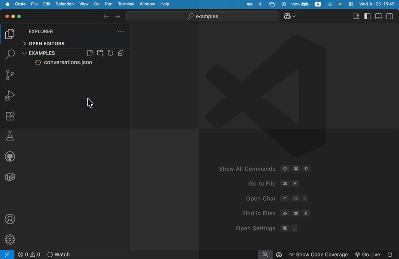

# ai-chat-md-export

[](https://www.npmjs.com/package/ai-chat-md-export)
[](https://github.com/sugurutakahashi-1234/homebrew-tap)
[](https://www.npmjs.com/package/ai-chat-md-export)
[](https://packagephobia.com/result?p=ai-chat-md-export)
[](https://github.com/sugurutakahashi-1234/ai-chat-md-export/actions/workflows/ci-push-main.yml)
[](https://codecov.io/gh/sugurutakahashi-1234/ai-chat-md-export)
[](https://opensource.org/licenses/MIT)
[](https://github.com/sugurutakahashi-1234/ai-chat-md-export/actions/workflows/cd-npm-release.yml)
[](https://github.com/sugurutakahashi-1234/ai-chat-md-export/releases)
[](https://github.com/sugurutakahashi-1234/ai-chat-md-export/pulls)

用于将 ChatGPT 和 Claude 聊天记录转换为可读 Markdown 文件的命令行工具



[English](README.md) | [日本語](README.ja.md) | [简体中文](README.zh-CN.md)

## Table of Contents

- [What is ai-chat-md-export?](#what-is-ai-chat-md-export)
- [Quick Start](#quick-start)
- [Installation](#installation)
- [Usage](#usage)
- [Command-line Options](#command-line-options)
- [Getting conversations.json](#getting-conversationsjson)
- [Troubleshooting](#troubleshooting)
- [Roadmap](#roadmap)
- [Contributing](#contributing)
- [Contact](#contact)
- [License](#license)

## What is ai-chat-md-export?

`ai-chat-md-export` 是一个**隐私优先**的 CLI 工具，可以将 ChatGPT 和 Claude 对话转换为有组织、可读的 Markdown 文件——完全在您的设备上离线运行。

### 🔒 Privacy-First Design

此工具在您的设备上本地运行：

- **本地处理** - 直接在您的机器上转换文件
- **无数据传输** - 您的对话永远不会离开您的设备
- **开源** - 查看我们的[代码](https://github.com/sugurutakahashi-1234/ai-chat-md-export)以准确了解它的功能

为希望将 AI 对话保持在自己控制下的注重隐私的用户设计的简单工具。

### Key Features

- 🚀 **快速高效** - 在几秒钟内处理数千个对话
- 📝 **清晰的 Markdown 输出** - 格式良好、可读的文件，带有时间戳和可视化标记
- 🔍 **高级过滤** - 按日期范围、搜索关键词过滤
- 📅 **智能组织** - 按日期命名文件，使用清理后的对话标题
- 💻 **跨平台** - 适用于 Windows、macOS 和 Linux

### Why Use This Tool?

- **使用纯文本文件** - 使用您最喜欢的文本编辑器、grep 或任何文本处理工具
- **完全控制您的数据** - 使用标准工具进行编辑、搜索、版本控制或分析
- **保存您的 AI 对话** - 在它们丢失或被删除之前保留永久记录
- **集成到您的工作流程** - 使用脚本处理、导入到笔记应用或使用自定义工具分析

## Quick Start

```bash
# 1. 安装工具
npm install -g ai-chat-md-export

# 2. 从 ChatGPT 或 Claude 导出您的对话
# → 获取 conversations.json 文件（参见下面的"Getting conversations.json"部分）

# 3. 转换为 Markdown
ai-chat-md-export -i conversations.json -p chatgpt
```

就这么简单！您的对话现在已经变成了组织良好、可搜索的 Markdown 文件。

### Example Output

运行上述命令将生成如下文件：

```
2025-01-15_Math_Question.md
2025-01-16_Recipe_Help.md
```

每个文件都包含格式优美的对话，带有时间戳、用户/助手标记，并保留了原始格式。

## What You'll Get

将复杂的 JSON 导出转换为清晰、可读的 Markdown：

### Input (conversations.json from ChatGPT)
```json
{
  "title": "Hello World",
  "create_time": 1736899200,
  "mapping": {
    "msg-1": {
      "message": {
        "author": { "role": "user" },
        "content": {
          "parts": ["你好！你好吗？"]
        }
      }
    },
    "msg-2": {
      "message": {
        "author": { "role": "assistant" },
        "content": {
          "parts": ["你好！我很好，谢谢您的问候。今天我能帮您做些什么？"]
        }
      }
    }
  }
}
```

### → Output (2025-01-15_Hello_World.md)
```markdown
# Hello World
Date: 2025-01-15 18:00:00 +09:00

---

## 👤 User
Date: 2025-01-15 18:00:00 +09:00

你好！你好吗？

---

## 🤖 Assistant
Date: 2025-01-15 18:00:10 +09:00

你好！我很好，谢谢您的问候。今天我能帮您做些什么？

---
```

✨ **特点**: 清晰的格式 • 时间戳 • 可视化标记 • 保留代码块和格式

## Installation

### Homebrew (macOS/Linux)

```bash
brew tap sugurutakahashi-1234/tap
brew install ai-chat-md-export
```

### npm

需要 Node.js 26 或更高版本。

```bash
npm install -g ai-chat-md-export
```

### Direct Download (Windows / Others)

预构建的二进制文件可从[发布页面](https://github.com/sugurutakahashi-1234/ai-chat-md-export/releases/latest)获取。

#### Windows
1. 下载 [ai-chat-md-export-windows-amd64.zip](https://github.com/sugurutakahashi-1234/ai-chat-md-export/releases/latest/download/ai-chat-md-export-windows-amd64.zip)
2. 解压缩文件
3. 将解压后的文件夹添加到PATH，或直接运行：
   ```cmd
   ai-chat-md-export.exe -i conversations.json -p chatgpt
   ```

#### macOS / Linux
从发布页面下载适合您平台的`.tar.gz`文件。


## Usage

```bash
# 基本用法：将 conversations.json 转换为 Markdown 文件
ai-chat-md-export -i conversations.json -p chatgpt

# 指定输出目录
ai-chat-md-export -i conversations.json -o output/ -p chatgpt

# 按日期或关键词过滤
ai-chat-md-export -i conversations.json -p chatgpt --since 2024-01-01 --search "Python"

# 导出为 JSON 格式
ai-chat-md-export -i conversations.json -p claude -f json

# 将所有对话合并到一个文件中
ai-chat-md-export -i conversations.json -p chatgpt --no-split
```

更多示例请参见 [examples](examples/) 目录。

## Command-line Options

| 选项                             | 描述                                         | 默认值     |
| -------------------------------- | -------------------------------------------- | ---------- |
| `-h, --help`                     | 显示帮助信息                                 | -          |
| `-v, --version`                  | 显示版本号                                   | -          |
| `-i, --input <path>`             | 输入文件路径（必需）                         | -          |
| `-p, --platform <platform>`      | 输入平台（`chatgpt`/`claude`）（必需）       | -          |
| `-o, --output <path>`            | 输出目录                                     | `.`        |
| `-f, --format <format>`          | 输出格式（`markdown`/`json`）                | `markdown` |
| `--since <date>`                 | 从日期过滤（YYYY-MM-DD）                     | -          |
| `--until <date>`                 | 截止日期过滤（YYYY-MM-DD）                   | -          |
| `--search <keyword>`             | 在对话中搜索。不区分大小写，搜索标题和消息   | -          |
| `--filename-encoding <encoding>` | 文件名编码（`standard`/`preserve`）          | `standard` |
| `--no-split`                     | 将所有对话合并到一个文件中（默认：分割文件） | -          |
| `--dry-run`                      | 预览模式，不创建文件                         | -          |
| `-q, --quiet`                    | 抑制进度消息                                 | -          |

## Getting conversations.json

ChatGPT 和 Claude 都允许您将聊天历史导出为 `conversations.json` 文件。该文件包含您所有的对话，采用我们的工具可以处理的结构化格式。

### Export from ChatGPT (OpenAI)

1. 登录 ChatGPT (https://chat.openai.com)
2. 点击页面右上角的用户头像
3. 点击"Settings"
4. 点击"Data Controls"菜单
5. 在"Export Data"下，点击"Export"
6. 在确认界面中，点击"Confirm export"
7. 您将收到一封包含数据导出的邮件
8. 点击"Download data export"下载.zip文件
9. 解压 ZIP 文件，找到 `conversations.json`

注意：邮件中的链接在 24 小时后过期。

有关最新的官方说明，请参阅：
https://help.openai.com/en/articles/7260999-how-do-i-export-my-chatgpt-history-and-data

### Export from Claude (Anthropic)

1. 访问 Claude (https://claude.ai)
2. 点击左下角的首字母缩写
3. 从菜单中选择"Settings"
4. 导航到"Privacy"部分（或 Enterprise 的"Data management"）
5. 点击"Export data"按钮
6. 您将收到包含下载链接的电子邮件
7. 下载并解压文件，找到 `conversations.json`

有关最新的官方说明，请参阅：
https://support.anthropic.com/en/articles/9450526-how-can-i-export-my-claude-data


## Troubleshooting

### Large files taking too long to process
对于非常大的对话历史：
- 使用 `--since` 和 `--until` 处理特定日期范围
- 如果遇到内存问题，请一次处理一个文件
- 使用 `--search` 仅提取相关对话

### Character encoding issues
如果在输出中看到乱码文本：
- 确保您的终端支持 UTF-8 编码
- 检查您的 `conversations.json` 文件是否正确编码

对于文件名编码问题：
- `--filename-encoding standard`（默认）：清理文件名以在操作系统之间实现最大兼容性
- `--filename-encoding preserve`：保留对话标题中的原始字符，但某些系统上的特殊字符可能会导致问题

### Missing conversations
如果某些对话未出现在输出中：
- 检查导出日期 - 仅包含截止到导出日期的对话
- 验证 JSON 结构是否与 ChatGPT 或 Claude 格式匹配
- 使用 `--dry-run` 预览将转换哪些对话

## Roadmap

### ✅ Completed Features

- [x] ChatGPT 对话导出支持
- [x] Claude 对话导出支持
- [x] 自动格式检测
- [x] 日期范围过滤（`--since`、`--until`）
- [x] 关键词搜索功能（`--search`）
- [x] 时区感知的时间戳转换
- [x] 预览的干运行模式（`--dry-run`）
- [x] 导出为 JSON 格式（`-f json`）
- [x] 将对话合并到单个文件（`--no-split`）
- [x] npm 包分发
- [x] Homebrew 公式支持

### 📋 Planned Features

- [ ] **JSON流式处理** - 处理大文件而无需将整个内容加载到内存中

## Contributing

欢迎贡献！有关开发设置、测试指南和如何提交拉取请求，请参见 [CONTRIBUTING.md](CONTRIBUTING.md)

## Contact

如果您有任何问题或反馈，可以在 X/Twitter 上联系我：[@suguru_takaha4](https://x.com/suguru_takaha4)

## License

MIT © [Suguru Takahashi](https://github.com/sugurutakahashi-1234)